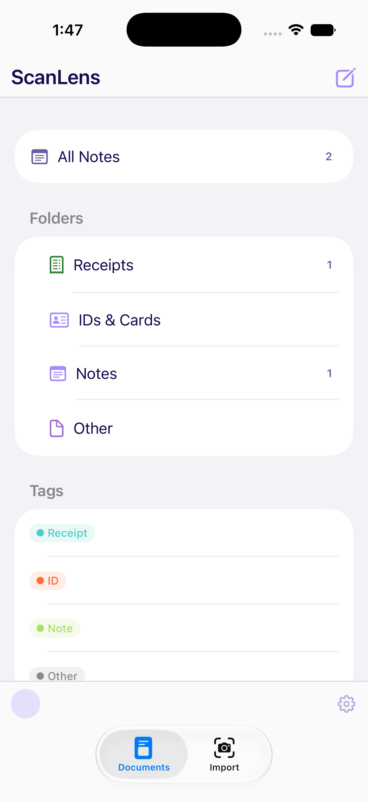
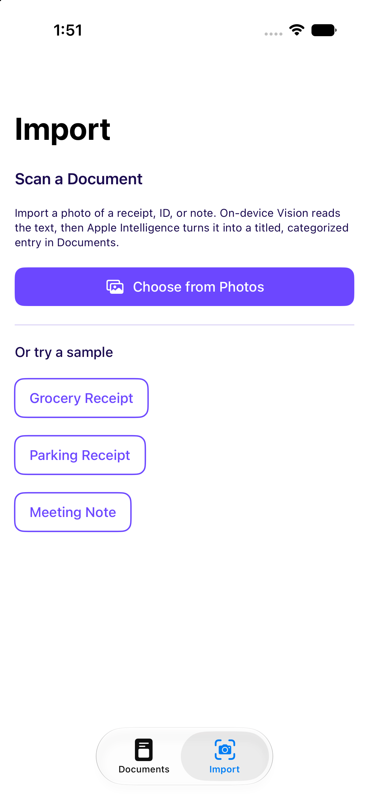
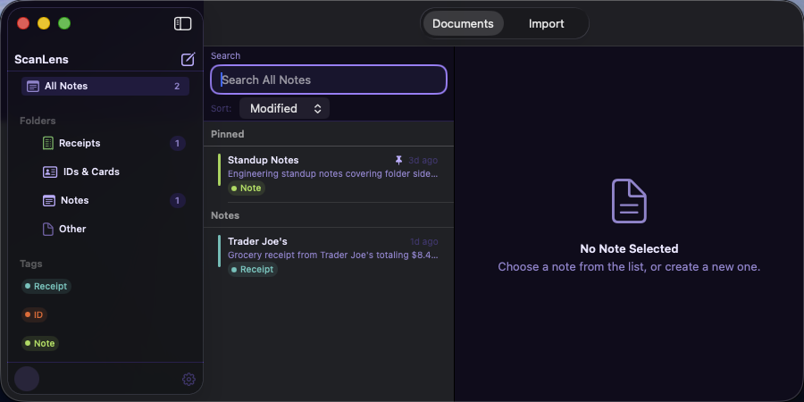
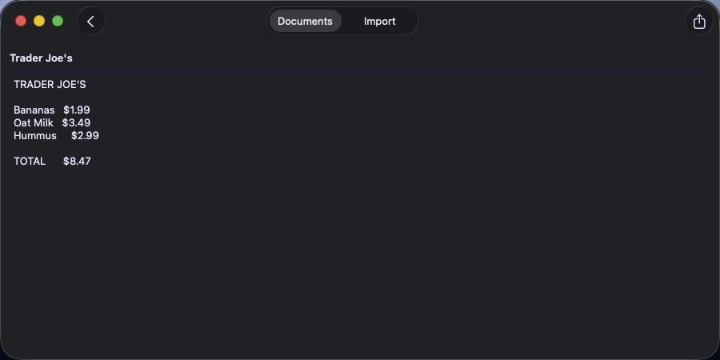

# ScanLens

[](https://github.com/NerdSnipe-Inc/ScanLens)
[](https://github.com/NerdSnipe-Inc/ScanLens)
[](LICENSE)
[](https://github.com/NerdSnipe-Inc/design-foundation)

**ScanLens** is an open-source [SwiftUI document scanner and receipt scanner app](https://github.com/NerdSnipe-Inc/ScanLens)
for **iOS and macOS** — a full-source, production-quality example, [universal across iPhone,
iPad, and Mac](https://github.com/NerdSnipe-Inc/ScanLens), that turns a photo of a receipt, ID,
or note into a searchable, categorized entry entirely on-device. It's part of the same "Lens"
family of full-source example apps as [BudgetLens](https://github.com/NerdSnipe-Inc/BudgetLens),
[ClientLens](https://github.com/NerdSnipe-Inc/ClientLens), [BookLens](https://github.com/NerdSnipe-Inc/BookLens),
and [AICompleteChat](https://github.com/NerdSnipe-Inc/AICompleteChat), all built on
[DesignFoundation](https://github.com/NerdSnipe-Inc/design-foundation) /
[DesignFoundation Pro](https://github.com/NerdSnipe-Inc/DesignFoundationPro).

The pipeline: import a photo (or try a bundled sample) → on-device Vision (`VNRecognizeTextRequest`)
reads the text → on-device Apple Intelligence (`LanguageModelSession` + `@Generable`) titles,
categorizes, and summarizes it → the result is saved and browsable in a folder/tag workspace
assembled from [DesignFoundation Pro's `Documents` UI kit](https://github.com/NerdSnipe-Inc/DesignFoundationPro).
No server round-trip, no API key, no cloud OCR or LLM cost.

Looking for a real-world **[SwiftUI OCR app example](https://github.com/NerdSnipe-Inc/ScanLens)**,
a working **[Vision framework text recognition example](https://github.com/NerdSnipe-Inc/ScanLens)**,
or a buildable reference for **[on-device Apple Intelligence document classification](https://github.com/NerdSnipe-Inc/ScanLens)**
on both iOS and macOS? This is a full app, not a snippet.

## Built With

- [**DesignFoundation**](https://github.com/NerdSnipe-Inc/design-foundation) — the free,
  open-source [SwiftUI design system](https://github.com/NerdSnipe-Inc/design-foundation) behind
  every button, text field, and theme in this app.
- [**DesignFoundation Pro**](https://github.com/NerdSnipe-Inc/DesignFoundationPro) — the premium
  [SwiftUI Documents UI kit](https://github.com/NerdSnipe-Inc/DesignFoundationPro) (folder
  sidebar, tag system, note list, and editor) ScanLens's Documents tab is assembled from.
- **Apple Vision** — on-device OCR via `VNRecognizeTextRequest`.
- **Apple Foundation Models** — on-device [Apple Intelligence](https://github.com/NerdSnipe-Inc/ScanLens)
  for titling, categorizing, and summarizing scanned text, via `LanguageModelSession` and `@Generable`.
- **SwiftData** — local persistence for scanned documents.

## Screenshots

### iPhone

| Documents (folders & tags) | Import |
|---|---|
|  |  |

### Mac

The same SwiftUI codebase, unmodified, running natively on macOS — DesignFoundation's
cross-platform theming handles the desktop three-column layout automatically, no `#if os(macOS)`
needed in app code.

| Documents (sidebar + note list) | Note editor |
|---|---|
|  |  |

## What it does

- **A folder/tag document workspace built from a real design system** —
  `DFDocumentBrowserScreen` and `DFDocumentEditorScreen`, fed with real SwiftData-persisted
  scans instead of fixture data.
- **On-device OCR** via Vision's `VNRecognizeTextRequest` — reads text out of any imported photo.
- **On-device AI classification** via `LanguageModelSession` + `@Generable` (Apple Intelligence,
  iOS 26+ / macOS 26+) — titles the document, sorts it into Receipts / IDs & Cards / Notes / Other,
  and writes a one-line summary. If the on-device model is unavailable *or* fails for any reason,
  the document still saves with the raw OCR text and a heuristic title/category — AI classification
  is an enhancement, never a requirement to save a scan.
- **Three bundled sample documents** (a grocery receipt, a parking receipt, a meeting note),
  rendered on the fly — so the full pipeline is demoable in Simulator or on Mac without needing a
  camera or a seeded Photos library.
- **SwiftData persistence** for every scanned document, with pin/delete/edit support round-tripped
  through the Documents vertical's real callbacks.

## Requirements

- iOS 18+ or macOS 15+ (AI classification in the Import flow additionally requires iOS 26+ /
  macOS 26+ with Apple Intelligence enabled to actually run on-device; OCR, import, and the
  Documents browser work fully on the iOS 18 / macOS 15 baseline)
- Xcode 26+
- [xcodegen](https://github.com/yonaskolb/XcodeGen) (`brew install xcodegen`) — this repo has no
  committed `.xcodeproj`; regenerate it from `project.yml`
- **A [DesignFoundationPro](https://github.com/NerdSnipe-Inc/DesignFoundationPro) license.** This
  is the one intentional gate: the source here is meant to be read and learned from by anyone,
  but it only actually *builds* for someone with access to DesignFoundationPro, since the
  Documents tab is assembled from its `Documents` vertical rather than built from scratch.

  Without access, package resolution fails outright — you'll see something like this during
  `xcodegen generate` + build, or from Xcode's own package resolution:
  ```
  error: Failed to clone repository https://github.com/NerdSnipe-Inc/DesignFoundationPro.git:
      remote: Repository not found.
      fatal: repository 'https://github.com/NerdSnipe-Inc/DesignFoundationPro.git/' not found
  ```
  That's expected, not a bug in this repo: it means your GitHub account isn't on
  DesignFoundationPro's access list. [Grab a
  license](https://github.com/NerdSnipe-Inc/DesignFoundationPro) to fix it.

[DesignFoundation](https://github.com/NerdSnipe-Inc/design-foundation) (the free design-system
core) is public and resolves automatically via Swift Package Manager.

## Building

```sh
git clone https://github.com/NerdSnipe-Inc/ScanLens.git
cd ScanLens
xcodegen generate
open ScanLens.xcodeproj
```

Build and run the `ScanLens` scheme (iOS, on a simulator or device) or the `ScanLensMac` scheme
(native macOS app). The app seeds two already-scanned documents on first launch so Documents
isn't empty before you've run Import yourself, on either platform.

## Architecture

```
ScanLens/
  ContentView.swift            — two-tab shell: Documents, Import
  Models/
    ScannedDocument.swift      — SwiftData model: title, extracted text, summary, category
    DocumentCategory.swift     — pure category ↔ folder/tag mapping (unit tested)
    SampleData.swift           — first-launch seed data
  Documents/
    DocumentsMapper.swift      — pure ScannedDocument → DFNoteModel/DFFolderModel/DFTagModel
                                  mapping (unit tested)
    DocumentsBrowserView.swift — DFDocumentBrowserScreen + DFDocumentEditorScreen, wired to
                                  modelContext for real save/pin/delete
  Import/
    TextRecognizer.swift          — on-device Vision OCR
    DocumentExtractionEngine.swift — LanguageModelSession + @Generable DocumentExtraction, iOS/macOS 26+
    SampleDocumentImageFactory.swift — renders the bundled sample documents (via ImageRenderer's
                                        cross-platform `cgImage`, no UIKit/AppKit dependency)
    ImportView.swift              — PhotosPicker + sample buttons + pipeline + status UI
```

### A note on API fit

DesignFoundationPro's own composed root for this vertical, `DFDocumentsRootView`, owns its notes
as private `@State` mutated in place — it's meant to be dropped in with its own fixture data, not
driven by an external store. ScanLens instead composes the same two screens
`DFDocumentsRootView` composes internally (`DFDocumentBrowserScreen` for the folder/tag/list
browser, `DFDocumentEditorScreen` for editing) but wires their callbacks to a real SwiftData
`modelContext` — the same pattern the vertical's own compact-width shell uses, just backed by
real persistence instead of fixtures. See `DocumentsBrowserView.swift` for the full mapping.

`project.yml` defines two application targets — `ScanLens` (iOS) and `ScanLensMac` (macOS) —
that both build from the same `ScanLens/` source folder. The only platform-specific code needed
was using `ImageIO`'s cross-platform `CGImageSource` instead of `UIImage` to decode a picked
photo, and `ImageRenderer`'s cross-platform `cgImage` property instead of `uiImage` to render the
bundled sample documents; DesignFoundation's theming and the Documents vertical's own
`NavigationSplitView`/compact-push layout switch handle the rest of the cross-platform adaptation
automatically.

## Related Projects

- [DesignFoundation](https://github.com/NerdSnipe-Inc/design-foundation) — the free SwiftUI
  design system this app (and its UI) is built on.
- [DesignFoundation Pro](https://github.com/NerdSnipe-Inc/DesignFoundationPro) — the premium
  vertical UI kits (Documents, Analytics, AI Chat, CRM, and more) ScanLens's Documents tab uses.
- [BudgetLens](https://github.com/NerdSnipe-Inc/BudgetLens) — the sibling full-source example
  app: an on-device AI personal budget tracker, universal across iOS and macOS, built the same way.
- [ClientLens](https://github.com/NerdSnipe-Inc/ClientLens) — the sibling full-source example
  app: an on-device AI CRM/client tracker built the same way.
- [BookLens](https://github.com/NerdSnipe-Inc/BookLens) — the sibling full-source example app: an
  on-device AI reading tracker built the same way.
- [AICompleteChat](https://github.com/NerdSnipe-Inc/AICompleteChat) — the sibling full-source
  example app: an on-device AI chat client built the same way.

## License

MIT — see [LICENSE](LICENSE). Note this only covers the code in *this* repo; DesignFoundationPro
is licensed separately (see its own repo).

---

**Keywords:** SwiftUI document scanner app, iOS and macOS OCR app example, receipt scanner
SwiftData, Vision framework text recognition example, on-device Apple Intelligence example,
Foundation Models Swift example, LanguageModelSession @Generable, universal SwiftUI app iOS and
macOS, SwiftUI design system, open source iOS and macOS app example.
